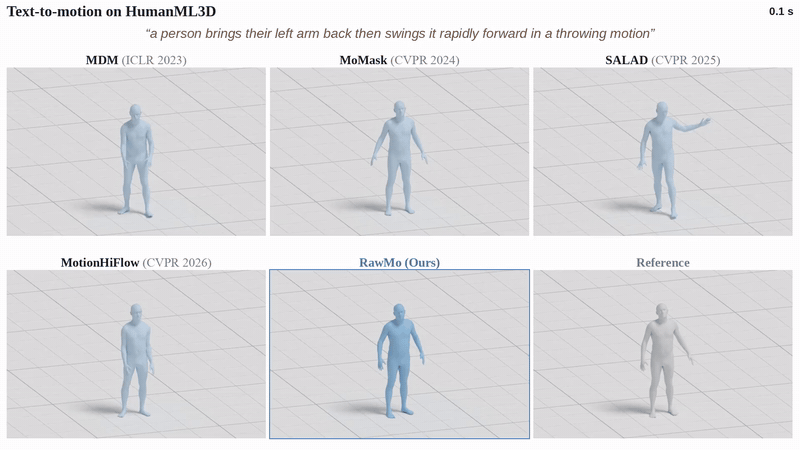
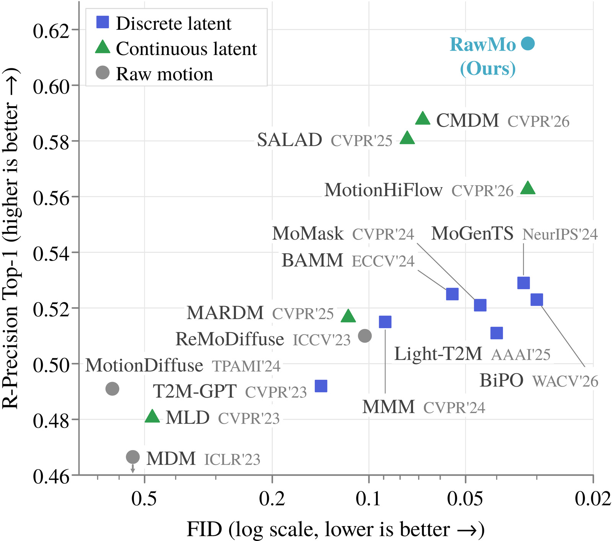
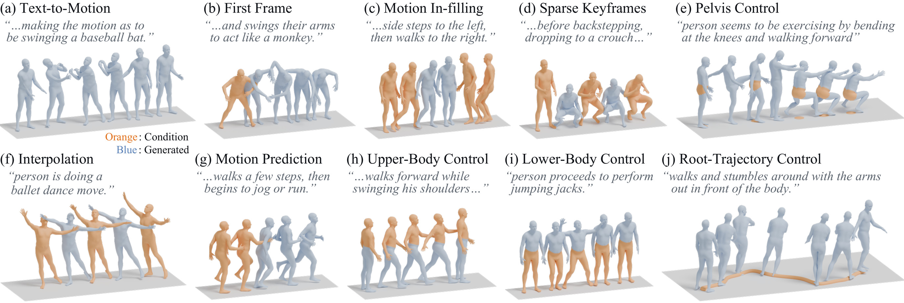
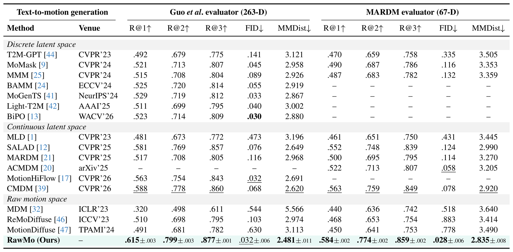
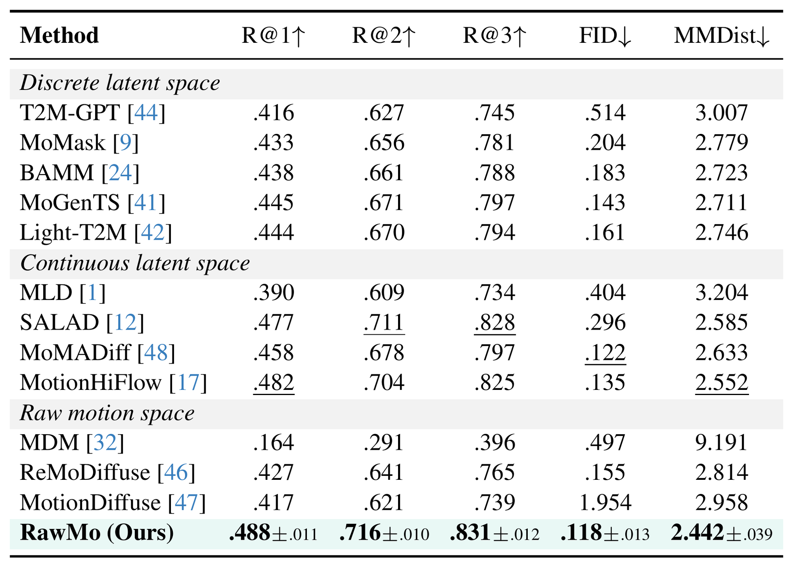
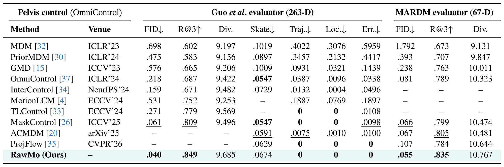
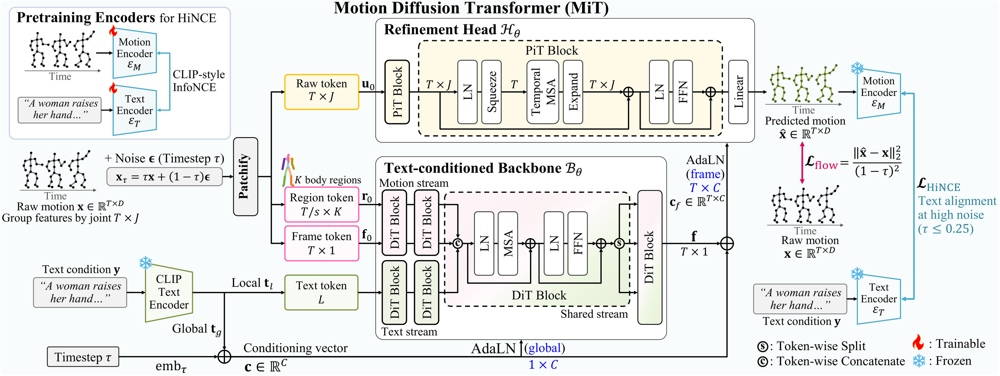

<p align="center">
  <picture>
    <source media="(prefers-color-scheme: dark)" srcset="assets/logo_dark.svg">
    
  </picture>
</p>

<div align="center">
<h2>Back to Raw Motion: Latent-Free Diffusion Transformers for Text-to-Motion and Exact Conditional Generation</h2>

<div>
    <a href='https://therealchenyun.github.io/' target='_blank'>Yun Chen</a><sup>*</sup>&nbsp;&nbsp;&nbsp;&nbsp;
    <a href='https://jeonghyeokdo.github.io/' target='_blank'>Jeonghyeok Do</a><sup>*</sup>&nbsp;&nbsp;&nbsp;&nbsp;
    <a href='https://www.viclab.kaist.ac.kr/' target='_blank'>Munchurl Kim</a><sup>†</sup>
</div>
<div>
    Korea Advanced Institute of Science and Technology (KAIST), South Korea
</div>
<div>
    <sup>*</sup>Equal contribution&nbsp;&nbsp;&nbsp;&nbsp;<sup>†</sup>Corresponding author
</div>
<br>
<div>
    <h4 align="center">
        <a href="https://kaist-viclab.github.io/RawMo_site/" target='_blank'></a>
        <!-- ARXIV_BADGE_START --><a href="https://arxiv.org/abs/2611.32793" target="_blank"></a><!-- ARXIV_BADGE_END -->
        
    </h4>
</div>
</div>

---

<div align="center">
    <h4>
        This repository is the official implementation of "Back to Raw Motion: Latent-Free Diffusion Transformers for Text-to-Motion and Exact Conditional Generation".
    </h4>
</div>

<div align="center">
    <a href="https://kaist-viclab.github.io/RawMo_site/" target='_blank'>
    
    </a>
    <p><sub>Text-to-motion on HumanML3D. Top: MDM, MoMask, SALAD; bottom: MotionHiFlow, <b>RawMo (Ours)</b> and the reference motion, for the same prompt.</sub></p>
    <p>▶️ <a href="https://kaist-viclab.github.io/RawMo_site/" target='_blank'><b>More videos on the project page</b></a></p>
</div>

## 📧 News
- **Nov 2026:** This repository is created. The code will be released soon.

## 📖 Abstract
As generative models tackle larger and more complex datasets, learned codecs enable efficient generation through compact latent representations, but may lose details and cannot guarantee exact preservation of given conditions. Generating directly in the original data space avoids errors introduced by the codec. Recent advances in image generation demonstrate that pixel diffusion can produce high-quality samples at practical computational costs. Inspired by these advances, we conduct a preliminary study of pixel diffusion, demonstrating its potential for adaptation to motion generation. Building on these findings, we present **RawMo**, a framework that brings text-to-motion generation to raw motion space. Our Motion Diffusion Transformer (MiT) models local skeletal structures and whole-body dynamics, while refining motion across frames to improve temporal consistency. Working directly in raw motion space further allows our high-noise text-motion alignment loss (HiNCE) to improve text consistency without intermediate motion decoding. RawMo supports multiple motion-conditioning tasks with a single conditional model while preserving given motion conditions exactly. Experiments on HumanML3D and KIT-ML show the best text alignment among compared methods and competitive motion quality, with ablations confirming the benefits of MiT and HiNCE.

## 📊 Results

### Text Alignment and Motion Quality
<div align="center">
    
</div>
<p align="center"><sub><b>Figure 1. Text-to-motion generation on HumanML3D.</b> RawMo achieves the highest R@1 with competitive FID under the 263-D evaluator of Guo et al. Marker shapes distinguish discrete latent, continuous latent, and raw-motion methods.</sub></p>

### Qualitative Results
<div align="center">
    
</div>
<p align="center"><sub><b>Figure 4. Qualitative results of RawMo.</b> (a) Text-to-motion generation; (b&ndash;j) motion-conditioned generation using a single conditional model. <b>Orange</b>: given motion conditions, which are preserved exactly; <b>blue</b>: generated motion.</sub></p>

### Quantitative Comparison
RawMo achieves the best text alignment among the compared methods on HumanML3D and KIT-ML with competitive motion quality, and a single conditional model preserves the given motion conditions exactly.

<div align="center">
    
</div>
<p align="center"><sub><b>Table 2. Text-to-motion generation on HumanML3D.</b> Left: the 263-D evaluator of Guo et al.; right: the 67-D evaluator of MARDM. RawMo achieves the highest R-Precision and lowest MMDist under both evaluators, with the lowest FID under the 67-D evaluator. <b>Bold</b> and <ins>underlined</ins> values mark the best and second-best results; &plusmn; denotes standard deviation.</sub></p>
<br>
<div align="center">
    
</div>
<p align="center"><sub><b>Table 3. Text-to-motion generation on KIT-ML.</b> Results use the 251-D evaluator of Guo et al. RawMo achieves the best scores across all five metrics.</sub></p>
<br>
<div align="center">
    
</div>
<p align="center"><sub><b>Table 4. Motion-conditioned generation on HumanML3D.</b> Pelvis control following OmniControl. A single conditional RawMo model achieves zero Traj., Loc., and Err., together with the best FID and R@3 under both evaluators.</sub></p>

More results and videos: [project page](https://kaist-viclab.github.io/RawMo_site/).

## 🖼️ Method Overview

<div align="center">
    
</div>

RawMo generates motion directly in raw motion space, without a learned motion codec.
- **Motion Diffusion Transformer (MiT).** Body-region and frame tokens share a text-conditioned backbone; a refinement head coordinates joint-level reconstruction across frames with temporal attention.
- **HiNCE.** A text-motion alignment loss supervises clean-motion predictions at high noise, without an intermediate motion decoder.
- **Exact motion conditioning.** A global skip keeps the given motion unchanged and completes the rest, so one conditional model preserves the given conditions exactly.

## 🚀 Code Release Plan
**The code and pretrained models will be released soon.**

- [ ] Inference code
- [ ] Pretrained models
- [ ] Training scripts
- [ ] Evaluation scripts

## 📑 Citation
If you find RawMo useful, please consider citing:
```BibTeX
@article{chen2026rawmo,
  title={Back to Raw Motion: Latent-Free Diffusion Transformers for Text-to-Motion and Exact Conditional Generation},
  author={Chen, Yun and Do, Jeonghyeok and Kim, Munchurl},
  journal={arXiv preprint arXiv:2611.32793},
  year={2026}
}
```
